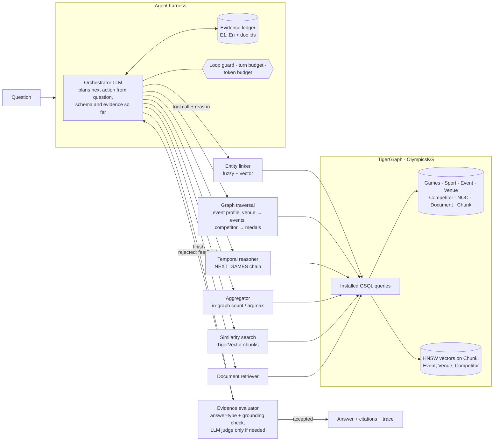

# When does a question need an agent?

**RAG vs GraphRAG vs Agentic GraphRAG on TigerGraph** — TigerGraph Agentic GraphRAG Hackathon, Round 1.

We built three pipelines over the same TigerGraph graph (typed knowledge graph + TigerVector embeddings of every
chunk) and benchmarked them on the 100 public questions, with full token and trace accounting.

| Pipeline | Accuracy | Exact match | Tokens / question | Tokens / correct answer | LLM calls | Citation recall |
|---|---:|---:|---:|---:|---:|---:|
| RAG | 51% | 48% | 2,939 | 5,819 | 1.0 | 43% |
| GraphRAG (single pass) | 66% | 66% | 4,585 | 6,948 | 1.0 | 55% |
| **Agentic GraphRAG** | **100%** | **99%** | **3,007** | **3,007** | 2.3 | **87%** |

Model `gpt-4.1-mini`, embeddings `text-embedding-3-small`. Full numbers: [results/summary.json](results/summary.json);
interactive dashboard: [results/dashboard.html](results/dashboard.html).

## The answer to the headline question

| Question type | RAG | GraphRAG | Agentic | Verdict |
|---|---:|---:|---:|---|
| Lookup ("How many nations competed in X?") | 89% | 95% | 100% | Agent optional: one retrieval finds the one document |
| Temporal ("…at the Games held immediately before 2016?") | 77% | 100% | 100% | Agent optional: the 1-hop `PREV_EDITION` expansion already reaches it |
| Multi-hop ("…the event held at VENUE on DATE?") | 39% | 75% | 100% | **Agent required**: venues host dozens of events; needs link → traverse → date filter |
| Superlative ("Which X event had the most competitors?") | 50% | 50% | 100% | **Agent required**: needs every event of a sport at a Games, not the top-k similar ones |
| Aggregation ("How many X events had more than N competitors?") | 2% | 0% | 100% | **Agent required**: counting over a set is impossible from retrieved snippets |

The finding: **the agent is not expensive when its tools are precise.** The agent spends *fewer* tokens than
single-pass GraphRAG because each tool returns a small, exact piece of evidence (context: 302 tokens on average vs
4,355 for GraphRAG). The agent's extra cost is latency from a second LLM round trip, which only pays off on
set-level (aggregation / superlative) and venue+date questions. On lookups, a single retrieval is already enough.

## Architecture



**Graph** ([gsql/schema.gsql](gsql/schema.gsql)): 2,951 documents → 2,162 `Event`s parsed from Olympic infoboxes,
20 `Games`, 41 `Sport`s, 304 `Venue`s, 5,248 `Competitor`s, 136 `NOC`s, 23,324 `Chunk`s. Edges: `AT_GAMES`,
`OF_SPORT`, `HELD_AT`, `WON_MEDAL(medal)`, `REPRESENTS`, `NEXT_GAMES` (chronology) and `NEXT_EDITION` (the same
event at the next Games, matched by sport + fuzzy event name). Graph construction is deterministic, with no LLM
extraction, so it is cheap, reproducible and exact. Before building anything we checked that the parsed infoboxes
reproduce **100/100** public gold answers, so the graph is a complete source of truth for this benchmark.

### The three pipelines

| | Retrieval | Generation |
|---|---|---|
| **RAG** ([agr/pipelines/rag.py](agr/pipelines/rag.py)) | Question embedding → top-8 chunks (TigerVector) | 1 LLM call |
| **GraphRAG** ([agr/pipelines/graphrag.py](agr/pipelines/graphrag.py)) | Vector seeds (top-6 events, top-2 venues, top-3 chunks) → 1-hop expansion over typed edges (`expand_seeds`) → entity records + triples + chunks | 1 LLM call |
| **Agentic GraphRAG** ([agr/pipelines/agentic.py](agr/pipelines/agentic.py)) | Orchestrator chooses among 8 tools, iterates on evidence | 2–7 LLM calls |

### Agentic design

- **Orchestrator.** Function-calling LLM. Its next action depends on the question, the schema in its prompt, and
  the evidence ledger. Every call carries a `reason`, recorded in the trace. Independent calls run in parallel.
- **Specialised agents.** `entity_linker`, `graph_traversal`, `temporal_reasoner`, `aggregator`,
  `similarity_search`, `doc_retriever`, `evidence_evaluator`. Most are deterministic (GSQL + fuzzy matching) and cost
  zero LLM tokens; the LLM is used only where judgement is needed.
- **Evidence evaluator.** Gates every `finish`. It (1) checks that the answer has the shape the question asks for
  (a *who* question must not be answered with an event title, *how many* must be a number); (2) checks the answer
  string is grounded in a ledger item; and (3) only when grounding fails, asks an LLM judge. A rejection is sent back
  to the orchestrator as feedback and logged as a strategy change.
- **Harness.** Evidence ledger (E1..En with doc ids), duplicate-call loop guard (which tells the orchestrator to
  change approach), a budget of 6 orchestrator turns and 60k tokens with a forced `finish`, per-tool context
  truncation, and precise citations (the event record that contains the answer, or every scanned event for
  aggregates).
- **Trace.** Every LLM, embedding, graph and tool operation is recorded with agent, duration, input, output,
  embedding and context tokens, plus decision events: `plan`, `action`, `strategy_change`, `loop_guard`,
  `evaluation`, `budget`, `stop` (with the reason for stopping).

Example trace (`python -m agr.ask "…men's 20 kilometres walk … held immediately before 2016?"`):

```
temporal_reasoner  neighbor_games(year=2016, season=Summer)   -- find the Games immediately before 2016
graph_traversal    lookup_event(Athletics, 2012, Summer, "Men's 20 kilometres walk")
>> evaluation: accepted "Chen Ding" · answer string found in E2
>> stop: evidence_sufficient after 3 orchestrator turns, 2 evidence items   (3,863 tokens)
```

## Reproduce

Requires Docker (TigerGraph Community Edition 4.2+, which includes TigerVector), Python 3.10+ and an OpenAI key.

```bash
python -m venv .venv && .venv/bin/pip install -r requirements.txt
cp .env.example .env                                  # add OPENAI_API_KEY; adjust TigerGraph host/port
# data/corpus/corpus.jsonl, data/question/eval_public.jsonl, data/question/eval_hidden.jsonl from the hackathon dataset

.venv/bin/python scripts/build_graph.py               # schema + typed graph + chunk/entity embeddings (~3 min)
.venv/bin/python scripts/install_queries.py           # install GSQL queries
.venv/bin/python -m agr.ask --pipeline all "Who won the gold medal in the event held at Richmond Olympic Oval on 14 February 2010?"

.venv/bin/python scripts/run_benchmark.py --split public    # 3 pipelines × 100 questions → results/public/*.jsonl
.venv/bin/python scripts/run_benchmark.py --split hidden    # 3 pipelines × 50 questions  → results/hidden/*.jsonl
.venv/bin/python scripts/evaluate.py                        # judge + metrics → results/summary.json
.venv/bin/python scripts/build_dashboard.py                 # → results/dashboard.html
.venv/bin/python scripts/export_submission.py               # → results/submission/hidden_<pipeline>.jsonl
```

Benchmark runs resume where they stopped (only missing or errored questions are re-run; `--force` re-runs all).
Embeddings are cached in `.cache/embeddings.sqlite`; reported embedding tokens are what an uncached run would cost.

## Evaluation method

- **Accuracy:** exact match after normalisation (accents, punctuation, case), otherwise an LLM judge scoring
  1 / 0.5 / 0 against the gold answer, with *complete* as a separate flag ([scripts/evaluate.py](scripts/evaluate.py)).
- **Grounding:** citation recall and precision against `gold_doc_ids`, plus retrieval recall.
- **Efficiency:** LLM input, output, embedding and context tokens per question; tokens per correct answer; LLM calls;
  latency.
- **Agentic behaviour:** tool calls, agents invoked, strategy changes, evaluator rejections, stop reasons.

## Repository layout

```
agr/                    library
  parse.py              deterministic infobox → typed records parser
  graph_tools.py        entity index, GSQL-backed traversals, vector search (shared by all pipelines)
  pipelines/            rag.py · graphrag.py · agentic.py · common.py
  tracing.py            per-question trace (ops + decision events), context-local
  llm.py                OpenAI chat/embedding wrappers with token accounting + embedding cache
  ask.py                CLI: answer one question and print its trace
gsql/                   schema.gsql, queries.gsql
scripts/                build_graph · install_queries · run_benchmark · evaluate · build_dashboard · export_submission
dashboard/template.html metrics dashboard template
results/                benchmark outputs, summary.json, dashboard.html, submission/
```

## Limitations and next steps

- The corpus is dominated by structured Olympic infoboxes, so a deterministic graph covers every benchmark
  question. Questions about the film/person articles would lean on `similarity_search` and `read_document`, which
  the benchmark exercises lightly.
- `NEXT_EDITION` links are fuzzy-matched (score ≥ 88), and the agent verifies temporal hops through `NEXT_GAMES`
  rather than trusting them.
- Team medallists are stored as run-together strings, as in the source infoboxes (`Dani KingLaura Trott…`).
- Next: an adaptive router that sends lookups to single-pass retrieval to save the extra round trip; LLM-extracted
  relations for the non-Olympic documents; Round 2 conflict and recency handling with versioned facts on edges.
