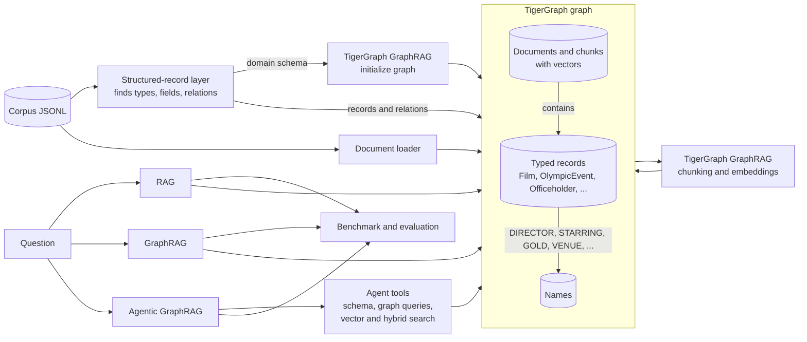

# Agentic GraphRAG on TigerGraph, built to work on any corpus

This project answers questions about a document collection in three ways, plain RAG, GraphRAG and Agentic
GraphRAG, and measures where each one succeeds and fails. All three run on TigerGraph's own GraphRAG engine over
the same graph, so the comparison is about the retrieval strategy and nothing else.

Our own contribution is a structured-record layer. It reads the corpus, finds the structured parts (here,
Wikipedia infoboxes), works out record types, typed fields and relations on its own, and hands them to TigerGraph
as the graph schema. With that schema the agent can count, filter, rank and traverse exactly, instead of guessing
from a few retrieved paragraphs. There is no topic-specific code anywhere in the project.

**Why it matters here.** The public benchmark only asks about Olympic events, but a quarter of the corpus (and
60% of its text) is about films, politicians, companies and other subjects. A held-out question can land on any
of it. To show the system really is general, we added a second question set, `general`, made only of
non-Olympic questions, and we report it next to the public results.

## How it works



The build happens in four steps.

1. Every document is loaded into TigerGraph.
2. Our record layer scans all the `key: value` blocks in the corpus and decides what they are. Each kind of block
   becomes a record type (we found 11: Film, OlympicEvent, Officeholder, Company, Album and others). Fields that
   hold numbers get a numeric copy, so "$13 million" becomes 13000000 and "142 minutes" becomes 142. Fields that
   hold dates get a year and an ISO date. Fields that list people or places, like director, starring, gold
   medallist or venue, become relations to shared Name nodes, which is what makes multi-hop questions possible.
3. TigerGraph GraphRAG takes this as its domain schema, installs its retrievers against it, then chunks and embeds
   every document so they can be found by vector search.
4. A short finishing step links each record to the chunk it came from, so a vector match on a chunk can lead the
   graph search straight to the record and its relations.

Rare kinds of blocks go into one generic Record type, so nothing is thrown away. Setting `RECORDS_ENABLED=0` turns
the layer off if you want plain GraphRAG.

### The three approaches

All three run on TigerGraph GraphRAG over the same graph.

| Approach | What happens |
|---|---|
| RAG | GraphRAG's similarity retriever finds the 5 closest chunks, and one LLM call answers from them. |
| GraphRAG | GraphRAG's hybrid retriever finds starting chunks by vector search and expands the graph two hops from there, and one LLM call answers. |
| Agentic GraphRAG | TigerGraph's planning agent writes a small plan for each question. A question about one named thing gets vector search only. A question that counts, ranks, compares or chains facts also gets a graph query step, which writes and runs a Cypher query over the typed records. If the plan comes back empty, the agent replans. It answers with citations, including the documents behind any graph rows it used. There is also a reactive variant that decides one step at a time. |

For RAG and GraphRAG we call the retrievers directly (`/graphrag/search`) and write the answer ourselves, with
the same prompt for both. We do this because the service's chat endpoint first asks an LLM router whether to use
the schema or the vector store, and with a typed schema it nearly always chose the schema, so both approaches
ended up running the same Cypher path. Calling the retrievers directly keeps the two honest, so the only
difference between them is what was retrieved. It also gives exact token counts from OpenAI's usage numbers.
The agentic approach goes through the service's chat endpoint, which reports its own token usage.

### Cost

Building the graph costs very little, because the expensive part of GraphRAG, asking an LLM to extract entities
from every chunk, is not needed on this corpus.

| Part | Cost on this corpus |
|---|---|
| Chunks and embeddings for all 2,951 documents | about $0.15 |
| Structured records | nothing, no LLM is involved |
| LLM entity extraction and communities | off by default, about $40 to $60 if switched on |

The records already hold the facts that extraction would produce, and they hold them exactly. For a corpus that is
mostly free text, extraction can be switched on with `EXTRACT_ENTITIES=true`.

Answering costs more than building. RAG and GraphRAG cost a fraction of a cent per question. The agent costs
about $0.012 per question, about 33,000 tokens, because every graph query step runs three LLM calls inside
TigerGraph GraphRAG (see the known limitations). A full benchmark run of all 183 questions with all three
approaches costs about $2.50.

## Results

All numbers come from one clean run with `gpt-4.1-mini` for every approach. Accuracy is graded against the gold
answers, exact match is the stricter score, and citation recall is the share of gold documents the answer cited.

| Public set (100 questions) | RAG | GraphRAG | Agentic GraphRAG |
|---|---:|---:|---:|
| Accuracy | 0.49 | 0.48 | **0.81** |
| Exact match | 0.45 | 0.44 | 0.74 |
| Citation recall | 0.41 | 0.41 | 0.40 |
| Tokens per question | 2,334 | 2,334 | 33,493 |
| Tokens per correct answer | 4,764 | 4,862 | 41,349 |

| Public accuracy by question type | RAG | GraphRAG | Agentic GraphRAG |
|---|---:|---:|---:|
| Lookup | 0.95 | 0.95 | 1.00 |
| Temporal ("immediately before") | 0.73 | 0.73 | 0.82 |
| Multi-hop | 0.39 | 0.39 | 0.71 |
| Superlative ("the most") | 0.30 | 0.30 | 0.90 |
| Aggregation (counting) | 0.05 | 0.00 | 0.71 |

| General set (33 non-Olympic questions) | RAG | GraphRAG | Agentic GraphRAG |
|---|---:|---:|---:|
| Accuracy | 0.42 | 0.45 | **0.88** |
| Tokens per question | 2,146 | 2,144 | 29,183 |

The answer to "where does agentic matter" is clear in these tables. For a question about one named thing, plain
RAG already gets 0.95 for a fraction of the tokens, and the agent adds little. For counting, ranking and chained
questions, retrieving a few paragraphs cannot work, because the answer depends on many records at once or on a
fact the question does not name. That is where the agent, writing graph queries over the typed records, goes
from almost nothing to between 0.7 and 0.9. GraphRAG's hybrid retriever gave no gain over RAG on this corpus. It used
the same number of tokens as RAG, which suggests its graph expansion mostly returned the same chunks.

### What it took to make TigerGraph's agent plan

Our first full run scored 0.46 for the agent, below plain RAG. Reading the service logs showed why: in 96 of the
100 questions the planner had failed and the agent had silently run its emergency plan, a single hybrid search.
Four things were wrong, and we fixed all four without changing TigerGraph's code, through the per-graph prompt
files the service already reads from `configs/graph_configs/<graph>/prompts/`.

1. The planner asks OpenAI for a typed plan in strict mode, and OpenAI rejects the plan schema because a step's
   arguments are a free-form object. The service then falls back to a plain call without saying which field names
   to use, so the model wrote `name` and `input` where the service expects `id` and `args`, and parsing failed.
   Our planner instructions (`infra/prompts/agentic_planner.txt`) spell out the fields, and say when a graph query
   step is worth its cost. With that, all 100 questions were planned and accuracy rose to 0.61.
2. The graph queries usually found nothing because the LLM could see field names but not values. It searched
   `games` for "2018 winter olympics" when the field holds "2018 Winter". The record layer now writes hints with
   the most common real values of every field and rules for numbers, years and counting
   (`query_guidance()` in `agr2/records/schema.py`). It is generated from whatever corpus is loaded, so it stays
   topic-agnostic.
3. TigerGraph's default Cypher prompt has no slot for those hints, although its code passes them in. Our
   `infra/prompts/generate_cypher.txt` is the service's own default prompt with the slot added.
4. The agent's queries run in TigerGraph's interpreted mode, which rejects some valid openCypher: sorting inside
   `WITH`, `IS NOT NULL`, and returning a whole vertex (which comes back as a bare id). The LLM wrote these
   often, so a "which film had the longest runtime" query failed three times and the agent fell back to guessing
   from paragraphs. We added these rules to the same Cypher prompt. On the six superlative questions of the
   general set this took the agent from 0 to 6 correct, and halved their tokens because the retries stopped.

The earlier results are kept in `results/baseline_planner_broken/` so the two runs can be compared.

## Question sets

| Set | File | Questions | Answers included |
|---|---|---:|---|
| public | `data/question/eval_public.jsonl` | 100 | yes, from the hackathon |
| hidden | `data/question/eval_hidden.jsonl` | 50 | no, these are for submission |
| general | `data/question/eval_general.jsonl` | 33 | yes, generated from the corpus |

The general set covers films and officeholders in the same five styles as the public set: simple lookups,
"immediately before" questions, multi-hop questions, counting questions and "which one had the most" questions.
`scripts/make_general_eval.py` builds it, and every answer can be checked against the corpus.

## Running it

You need Docker, Python 3.10 or newer and an OpenAI key. The TigerGraph images are the official ones from the
TigerGraph GraphRAG tutorial.

Set up Python and your settings once:

```bash
python3 -m venv .venv
.venv/bin/pip install -r requirements.txt
cp .env.example .env          # then put your OPENAI_API_KEY in it
```

Only copy `.env.example` the first time. Copying it again replaces your key with the `sk-...` placeholder, and
every OpenAI call then fails with a 401 error.

### Everything in one command

```bash
bash scripts/fresh_run.sh
```

This starts TigerGraph and the GraphRAG service, drops the graph named by `TG_GRAPH` in `.env`, deletes the old
results, builds the graph from the whole corpus, waits for chunking and embedding to finish, links the records,
checks that the chunks really have embeddings, asks one sample question with all three approaches, runs the
public, general and hidden question sets, scores them and writes the submission files. Everything it prints is
also saved to `results/fresh_run_<time>.log`.

| Option | What it does |
|---|---|
| `bash scripts/fresh_run.sh --no-benchmark` | stops after the sample question |
| `SAMPLE=100 bash scripts/fresh_run.sh --no-benchmark` | builds a 100 document sample, for a quick check that everything works |

Run only one copy at a time, and let it finish. The script restarts the GraphRAG containers, so a second copy
started during a build stops the embedding part way, and the benchmark then runs on a graph where most chunks
cannot be found.

### Step by step

Write the service config from your `.env`. Do this again whenever you change `.env`, then restart the service:

```bash
.venv/bin/python infra/render_config.py
```

Start TigerGraph and the GraphRAG service:

```bash
docker compose -f infra/docker-compose.yml up -d
docker compose -f infra/docker-compose.yml exec tigergraph /home/tigergraph/tigergraph/app/cmd/gadmin start all
docker compose -f infra/docker-compose.yml restart graphrag graphrag-ecc chat-history
```

Build the graph. The status script waits until chunking and embedding are done, the finishing step links the
records, and the vector check makes sure the chunks can be found:

```bash
.venv/bin/python scripts/build_graph.py
.venv/bin/python scripts/graph_status.py --watch
.venv/bin/python scripts/finalize_graph.py
.venv/bin/python scripts/check_vectors.py
```

Try a single question:

```bash
.venv/bin/python scripts/ask.py --pipelines rag,graphrag,agentic "Who directed the film The English Patient?"
```

Run the benchmark, score it and export the submission:

```bash
.venv/bin/python scripts/run_benchmark.py --split public
.venv/bin/python scripts/run_benchmark.py --split general
.venv/bin/python scripts/run_benchmark.py --split hidden
.venv/bin/python scripts/evaluate.py
.venv/bin/python scripts/export_submission.py
```

To stop everything, run `docker compose -f infra/docker-compose.yml stop`. Nothing is deleted, and the graph is
still there next time.

### If something goes wrong

| What you see | Why, and what to do |
|---|---|
| `Incorrect API key provided: sk-...` in the service logs | The service config still has the placeholder key. Put your key in `.env`, run `infra/render_config.py` and restart the three GraphRAG containers. |
| `Connection reset by peer` on port 14240 | Another TigerGraph is using the port (the first round version uses the same one), or the port line in `infra/docker-compose.yml` has been changed. It must read `"14240:14240"`. |
| `check_vectors.py` says too many chunks have no embedding | The build was interrupted. Run `bash scripts/fresh_run.sh` again, which drops the graph and starts clean. |
| The build repeats `initialize_graph: running` for more than 10 minutes | Check `docker compose -f infra/docker-compose.yml logs graphrag --tail 50`. |

Run the unit tests with `.venv/bin/python -m pytest tests -q`.

If you want to try things on a small scale first, `build_graph.py --sample 100` builds a 100-document sample.
Every step is safe to run again, because documents that are already in the graph are skipped.

## What is in the repository

| Folder | What it holds |
|---|---|
| `agr2/` | The library. `config.py` reads settings, `tg.py` talks to TigerGraph and the GraphRAG service, `pipelines.py` runs the three approaches, and `records/` is the structured-record layer. |
| `scripts/` | The commands above, from building the graph to exporting the submission. `fresh_run.sh` runs them all in order. |
| `infra/` | Docker setup for TigerGraph and GraphRAG, the service config template, and in `infra/prompts/` our planner and Cypher prompts, which `render_config.py` copies into the service's per-graph prompt folder. |
| `data/question/` | The three question sets. |
| `results/` | Benchmark outputs, scores, the inferred schema and the dashboard. |
| `tests/` | Unit tests for the record layer. |

## Known limitations

- Politicians who held several offices keep all their offices and predecessors on one record, so which
  predecessor goes with which office is lost. The text is still searchable, so the agent can recover it.
- Hybrid search shows a record by its type and id only. The fields are read by the agent's graph queries.
- The general question set is generated from infobox fields, so it leans towards structured questions.
- The agent's graph query step is expensive. Inside TigerGraph GraphRAG it first maps the question to the schema,
  then tries to generate a pyTigerGraph function call, and only then writes Cypher. With TigerGraph's own vector
  store the list of allowed functions is always empty, so the function step can never succeed, and the first two
  calls (about 12,000 tokens) are wasted on every graph query. We left TigerGraph's code alone rather than patch it.
- The MCP add-ons in the published GraphRAG image fail to load (`cannot import name 'streamablehttp_client'`, a
  package version mismatch), so external tools cannot be attached to the agent yet.

## Built with

TigerGraph Community Edition 4.2 and TigerGraph GraphRAG (github.com/tigergraph/graphrag), OpenAI
`gpt-4.1-mini` and `text-embedding-3-small`.
